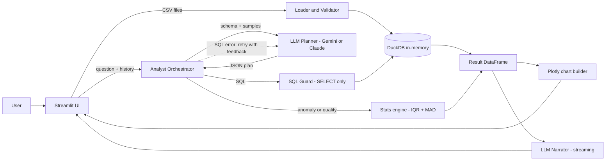

# 📊 AI Data Analyst

Upload one or more CSV files and talk to your data in plain English. The app answers questions, writes SQL/Pandas,
draws charts, flags anomalies (with reasons), checks data quality and remembers the conversation.

> **Demo:** _add your 10–30s video / live link here_ &nbsp;|&nbsp; **Screenshots:** _add to `docs/` and link here_

## Features
| Requirement | Implementation |
|---|---|
| Upload & validate CSVs | `analyst/loader.py` – extension, empty, size, encoding/delimiter sniffing, column cleaning, date parsing |
| NL questions / insights | LLM plans → DuckDB executes → LLM narrates (streamed) |
| Charts | Bar, Line, Pie, Scatter, Histogram via Plotly (`charts.py`) |
| SQL / Pandas code | Shown in every answer's "SQL / Pandas code" expander |
| Anomaly detection + why | IQR fences confirmed by modified z-score (MAD); each row has a human-readable reason (`anomaly.py`) |
| Reasoning | "🧠 Reasoning" expander per answer |
| Conversation context | Last 4 turns (8 messages) (question + SQL + summary) sent to the planner – "now as a pie chart" works |
| Multi-provider LLM | Gemini (free tier) and Claude, auto-detected from the API key (`llm.py`) |
| **Bonus** | Multi-file joins, data-quality checks, streaming, SQL self-correction, logging, Markdown report export, tests, Docker |

## Architecture


**Flow:** (1) planner returns JSON `{intent, reasoning, sql, pandas, chart}` → (2) SQL is validated, executed on DuckDB; on SQL error the
error is fed back to the LLM for one automatic correction → (3) chart is built → (4) narrator streams a business summary grounded in the real result rows.

## Quick start
```bash
git clone <your-repo> && cd ai-data-analyst
cp .env.example .env            # add GEMINI_API_KEY (free) or ANTHROPIC_API_KEY
python -m venv .venv && source .venv/bin/activate
pip install -r requirements.txt
streamlit run app.py            # http://localhost:8501
```
**Docker:** `docker compose up --build`

Upload `data/sales.csv` + `data/customers.csv`, then try:
*"Which region generated the highest revenue?"*, *"Show monthly sales trends"*, *"Top 5 customers by revenue (join customers)"*,
*"Now show it as a pie chart"*, *"Generate SQL for this analysis"*, *"Detect anomalies"*, *"Run a data quality check"*.

## Tests
`pytest -q` – loader validation, SQL guard, anomaly/quality logic, and the agent (with a fake LLM: query, follow-up memory, SQL self-correction, unsafe SQL, anomaly intent). No API key needed.

## Safety & production notes
- LLM SQL passes a guard: single statement, `SELECT/WITH` only, blocklist (DDL/DML, `read_csv`, `ATTACH`, `COPY`, `PRAGMA`…). Results capped at 5,000 rows. Pandas code is **display-only, never executed**.
- Data lives in an in-memory DuckDB per session; nothing is persisted. Only schema + 3 sample rows + result previews are sent to the LLM.
- Errors (bad file, LLM outage, unsafe/invalid SQL) are shown in the UI instead of crashing; everything is logged to `logs/app.log` (question, intent, latency, token usage).

## Assumptions
- Files are comma/semicolon/tab-delimited CSV ≤ 50 MB (`MAX_UPLOAD_MB`); column names are normalised to `snake_case`.
- "Underperforming" = lowest / below-average on the relevant metric (planner decides).
- Anomaly detection is univariate per numeric column; the LLM explains, statistics decide.
- Join keys are inferred by the LLM from column names (e.g. `customer_id`).

## Structure
```
app.py                Streamlit UI
analyst/              loader, sql_guard, agent, llm, anomaly, charts, report, logging_conf
data/                 sample sales.csv & customers.csv (scripts/generate_sample_data.py)
tests/                pytest suite
Dockerfile, docker-compose.yml
```
## Ideas for next steps
Forecasting, auth, caching of identical plans, eval set of question→expected-SQL pairs, multivariate anomaly detection (Isolation Forest).
